<!-- ============================================ -->
<!--   PATRIC AUGUSTO · GITHUB PROFILE README     -->
<!--   Tema: Solarpunk Minimalista               -->
<!--   Posição: IA aplicada na fronteira,         -->
<!--            expandindo para engenharia de sistemas -->
<!-- ============================================ -->

  

  

  
  
  

 

<h3 align="center">🌿 Sobre mim</h3>

  Desenvolvedor Full Stack que constrói produtos que entregam valor real. 
  Foco em código limpo, performance e experiências de usuário fluidas — 
  operando na fronteira da <strong>IA aplicada</strong> e expandindo-me para além dela.

  🔭 <strong>IA aplicada em produção</strong> &nbsp;·&nbsp; 🚧 <strong>Arquitetura de microsserviços e sistemas</strong> &nbsp;·&nbsp; 📍 Brasil 🇧🇷

 

<h3 align="center">🧭 Fronteira da IA aplicada</h3>

Conceito que mantém o README e o perfil orientados pela mesma direção:

  <strong>IA aplicada</strong> — produto máximo da engenharia moderna. 
  <strong>Expansão</strong> — toda IA que funciona em produção precisa de um sistema sólido por trás.

 

<h3 align="center">🔭 O que estou trabalhando agora</h3>

  🛠 <strong>IA aplicada</strong> — integrando LLMs, pipelines e agentes a fluxos reais de produto, com foco em UX, avaliação e confiabilidade. 
  🏗 <strong>Expansão para além da IA</strong> — arquitetura de microsserviços, infraestrutura e sistemas que sustentam o que a IA entrega em produção. 
  📚 <strong>Em andamento</strong> — estudando IA/ML e arquitetura de software para caminhar com o que está começando.

 

<h3 align="center">🍃 Tech Stack</h3>

<strong>Frontend</strong>

  
  
  
  

<strong>Backend</strong>

  
  
  

<strong>Banco de dados & Infra</strong>

  
  
  
  

 

  

 

  ✦ Atualizado em 2026 &nbsp;·&nbsp; feito com 🌱 e café

